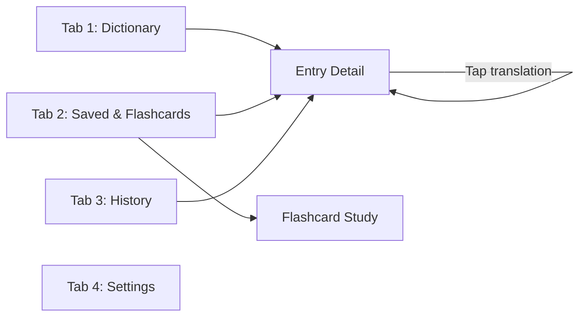

# Features & UI/UX Specification (Shared: Android & iOS)

## 1. Core Experience: Mode Switching + Mixed-Language Inline Search

Users switch between two bidirectional modes at the top of the Search screen:
* **`TJK ⇄ RUS`** (Tajik + Russian)
* **`TJK ⇄ ENG`** (Tajik + English)

There is no manual `TJ → RU` vs `RU → TJ` flip button. The single inline search field accepts both languages of the active mode simultaneously, tags every result row with a colored language pill (`TJ`, `RU`, `EN`), and lets the user tap the exact word they meant.

Example query **`дар`** in **`TJK ⇄ RUS`**:
* `[TJ]` **дар** · *prep.* — в, на
* `[TJ]` **дар** · *n.* — дверь
* `[RU]` **дар** · *n.* — тӯҳфа, ҳадя
* `[TJ]` **дарс** · *n.* — урок, занятие

### Why This Works for Tajik Users
1. **Keyboard-friendly folding:** Most users type Tajik on a Russian keyboard without `ғ ӣ қ ӯ ҳ ҷ`. Our shared `TextNormalizer` folds `ғ→г`, `қ→к`, `ҳ→х`, `ҷ→ч`, `ӣ→и`, `ӯ→у` (while preserving `й`) so `хурдан` finds `хӯрдан`.
2. **On-screen Tajik letter bar:** A quick-insert bar `ғ ӣ қ ӯ ҳ ҷ` sits directly below the search input for one-tap insertion.
3. **Cross-mode language hint:** Typing Latin (`hello`) while in `TJK ⇄ RUS` shows a one-tap banner offering to switch to `TJK ⇄ ENG`.

---

## 2. Visual Design & Palette

| Token | Light Mode | Dark Mode | Purpose |
|---|---|---|---|
| **Primary Accent** | `#006A3A` | `#7FD8A4` | Active tabs, stars, Tajik flag emerald |
| **Secondary Accent** | `#C8102E` | `#FFB3B0` | Highlights |
| **`TJ` Tag** | `#00843D` | `#5BD18B` | Tajik entry badge |
| **`RU` Tag** | `#1E5BC6` | `#8AB4FF` | Russian entry badge |
| **`EN` Tag** | `#C2410C` | `#FFA36C` | English entry badge |

---

## 3. Screen Wireframes

### Search (Home & Inline Results)

```text
┌─────────────────────────────────────┐    ┌─────────────────────────────────────┐
│        [ TJK ⇄ RUS | TJK ⇄ ENG ]    │    │        [ TJK ⇄ RUS | TJK ⇄ ENG ]    │
├─────────────────────────────────────┤    ├─────────────────────────────────────┤
│  🔍                              ✕  │    │  🔍 дар                          ✕  │
│  [ ғ ] [ ӣ ] [ қ ] [ ӯ ] [ ҳ ] [ ҷ ]│    │  [ ғ ] [ ӣ ] [ қ ] [ ӯ ] [ ҳ ] [ ҷ ]│
├─────────────────────────────────────┤    ├─────────────────────────────────────┤
│  ★ WORD OF THE DAY          [TJ]    │    │  [TJ] дар    prep.                  │
│  муваффақият (n.)                   │    │       в, на                         │
│  успех · success                    │    │─────────────────────────────────────│
├─────────────────────────────────────┤    │  [TJ] дар    n.                     │
│  RECENT SEARCHES             Clear  │    │       дверь                         │
│  [TJ] салом    привет, здра...      │    │─────────────────────────────────────│
│  [RU] книга    китоб                │    │  [RU] дар    n.                     │
│                                     │    │       тӯҳфа, ҳадя                   │
└─────────────────────────────────────┘    └─────────────────────────────────────┘
│  Dict   │  Saved  │ History │ Sett  │    │  Dict   │  Saved  │ History │ Sett  │
```

### Entry Detail

```text
┌─────────────────────────────────────┐
│  ←   дар                        ★   │
├─────────────────────────────────────┤
│  [TJ]  noun  ·  [home]              │
│  дар                                │
│  [ 🔊 Listen ] [ ⧉ Copy ] [ ↗ Share] │
├─────────────────────────────────────┤
│  RUSSIAN                            │
│  • [RU] дверь                      ›│  ← Tappable (opens RU entry)
│                                     │
│  ENGLISH                            │
│  • [EN] door                       ›│  ← Tappable (opens EN entry)
├─────────────────────────────────────┤
│  EXAMPLES                           │
│  ┌───────────────────────────────┐  │
│  │ Дарро пӯшед.                  │  │
│  │ Закройте дверь.               │  │
│  │ Close the door.               │  │
│  └───────────────────────────────┘  │
└─────────────────────────────────────┘
```

### Navigation Architecture



---

## 4. Complete Feature Matrix

| Category | Feature | Status |
|---|---|---|
| **Search** | `TJK ⇄ RUS` & `TJK ⇄ ENG` mode switcher | Phase 0 |
| **Search** | Mixed-language inline search with `[TJ]`/`[RU]`/`[EN]` badges | Phase 0 |
| **Search** | Tajik keyboard folding (`ғ→г, қ→к, ҳ→х, ҷ→ч, ӣ→и, ӯ→у`) | Phase 0 |
| **Search** | Quick-insert bar `ғ ӣ қ ӯ ҳ ҷ` | Phase 0 |
| **Search** | Cross-mode detection & one-tap switch hint | Phase 0 |
| **Search** | Fuzzy / typo fallback + Tajik inflection stemming | Phase 1 |
| **Browse** | Topic / Category phrasebook filter (`food`, `travel`, `home`, …) | Phase 1 |
| **Entry** | Grouped tappable translations, usage notes, trilingual examples | Phase 0 |
| **Entry** | Copy, Share, Favorite toggle, offline RU/EN TTS | Phase 0 |
| **Study** | Word of the Day (deterministic offline) | Phase 0 |
| **Study** | Saved words + 200-item History (persisted separately from dictionary DB) | Phase 0 |
| **Study** | Offline SM-2 Spaced-Repetition Flashcard quiz + daily streak | Phase 2 |
| **Study** | Speech speed toggle & adjustable entry font size | Phase 2 |
| **OS** | Android `ACTION_PROCESS_TEXT` & Share lookup | Phase 0 |
| **OS** | Home Screen Word-of-the-Day Widgets + Favorites JSON Backup | Phase 3 |
| **UI** | Localized UI in English, Russian, and Tajik (`en`, `ru`, `tg`) | Phase 0 |
| **UI** | Light / Dark / System appearance | Phase 0 |
